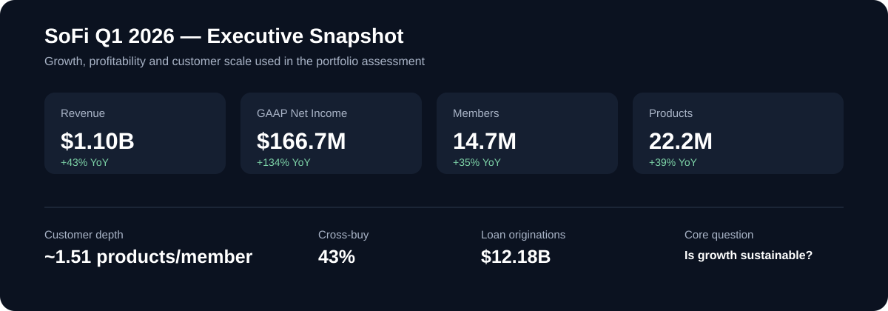
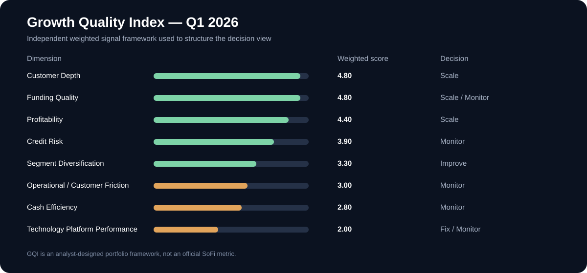

# SoFi Q1 2026 Growth Quality Assessment

  

**Business question:** *Is SoFi's rapid Q1 2026 growth also high-quality and sustainable?*

I built this analysis to answer a question that matters in FinTech: was SoFi's Q1 2026 growth real, durable, and high-quality OR was it simply a strong headline story backed by volume?

The short answer is: the growth was meaningful, but the quality story was mixed.

  

## Why this project matters

Growth metrics alone can be misleading. A business can show strong revenue expansion while still facing weak cash conversion, unstable funding conditions, operational friction, or uneven customer engagement. This project was designed to evaluate that question in a structured way. The goal was not to label SoFi as simply good or bad, but to assess whether the growth pattern appeared durable, economical, and supported by underlying business quality.

## Business question

Is SoFi's rapid Q1 2026 growth also high-quality and sustainable?

SoFi was clearly growing fast. The issue was not whether the business was scaling — it was whether that scale was translating into deeper customer engagement, stronger unit economics, healthier funding, and a more resilient operating model.

I approached the problem as a business analyst rather than a market commentator: using public filings, operating data, customer-friction signals, and a structured scorecard to separate volume growth from underlying quality.

## What I did

- Framed the business question and translated it into analytical requirements.
- Defined KPIs, formulas, denominators, and source traceability.
- Reviewed public SEC and investor materials alongside CFPB complaint evidence.
- Modeled the analysis in SQL and structured the outputs in Excel.
- Built a Power BI reporting layer and an interactive HTML summary for stakeholder presentation.
- Created a transparent scorecard to show where the quality story looked stronger and where it looked weaker.

## What I learned

The biggest lesson from this work was that business quality is rarely visible in the headline numbers alone. Revenue growth, customer counts, and product expansion can all look strong while the underlying economics remain fragile or inconsistent.

I also learned how important it is to separate a directional signal from a firm conclusion. Public data can be highly informative, but it is never the full story.

## What this repository contains

This repository contains the complete project package and the supporting analytical materials behind it:

- [Interactive HTML report](documents/SoFi_Q1_2026_Growth_Quality.html)
- [Power BI dashboard PDF](dashboard/SoFi_Q1_2026_Growth_Quality_Analysis_Dashboard.pdf)
- [Power BI file](dashboard/SoFi_2026_Growth_Quality_Dashboard.pbix)
- [Executive presentation](presentation/SoFi-Q1-2026-Growth-Quality-Assessment_.pdf)
- [Business and analytical requirements](documents/Business_Requirements_Analytical_Requirements.md)
- [KPI dictionary](documents/KPI_Dictionary.md)
- [Data source mapping](documents/Data_Source_Mapping.md)
- [GQI methodology](methodology/GQI_Methodology.md)
- [CFPB evidence notes](documents/CFPB_Evidence_Notes.md)
- [SQL scripts and run notes](sql/README.md)
- [Excel analytical bridge](analysis/SoFi_2026_Growth_Quality_PowerBI_Excel_Bridge.xlsx)

## Repository map

- `documents/` -> definitions, requirements, source mapping, and business evidence
- `sql/` -> validation and analytical logic used to prepare the data
- `analysis/` -> Excel bridge between SQL outputs and the reporting layer
- `dashboard/` -> reporting assets and final Power BI output
- `presentation/` -> executive presentation package
- `methodology/` -> framework used to evaluate quality signals
- `index.html` -> interactive source report

## Key findings

| Metric | Q1 2026 |
|---|---:|
| Consolidated net revenue | $1.10B (+43% YoY) |
| GAAP net income | $166.7M |
| Members | 14.7M (+35% YoY) |
| Products | 22.2M (+39% YoY) |
| Loan originations | Approximately $12.2B |
| Products per member | Approximately 1.51 (project-derived) |
| Share of new products from existing members | 43% (company-reported) |

The analysis surfaces several important nuances that matter in a quality assessment:

- Cash conversion needs context. GAAP net income was positive, but operating cash flow was negative during the period.
- Funding ratio is not a verdict. Deposits relative to loans can be informative, but do not prove full funding quality by themselves.
- Segment mix matters. The project distinguishes between consolidated and segment-level revenue denominators to avoid misleading comparisons.
- Credit and customer-friction signals are directional, not definitive. They are included as evidence points rather than a final conclusion.

## Growth Quality scorecard

I built the scorecard to summarize the signal quality across the core business dimensions, without pretending that a single number could settle the question. The scorecard below reflects analyst-selected weightings across the main dimensions of performance and risk.

| Dimension | Raw signal | Analyst-selected weight |
|---|---:|---:|
| Customer Depth | 4/5 | 1.20 |
| Funding Quality | 3/5 | 1.20 |
| Profitability | 4/5 | 1.10 |
| Credit Risk | 3/5 | 1.30 |
| Segment Diversification | 3/5 | 1.10 |
| Operational / Customer Friction | 3/5* | 1.00 |
| Cash Efficiency | 2/5 | 1.40 |
| Technology Platform Performance | 2/5 | 1.00 |

*Customer-friction score is provisional while the CFPB source evidence is incomplete.

## My assessment

What stood out most to me was this:

- SoFi showed real customer expansion and product depth.
- The growth engine looked active and scalable.
- But the quality story was less clean than the headline growth suggested.
- Cash conversion, funding context, and customer-friction risk all required more careful interpretation.
- That is why I did not treat the business as simply "strong" or "weak." The more honest conclusion is that the growth looked promising, but not yet fully de-risked.

## Limitations and disclosure

This is an independent analysis based on public information, not an internal SoFi engagement. No internal customer-service, transaction, or management data were available. I did not use insider information or non-public operating data.

## Data sources and transparency

Primary sources include:

- SEC Q1 2026 Form 10-Q
- SoFi investor materials and quarterly results
- SoFi Q1 2026 earnings release
- CFPB Consumer Complaint Database as a public customer-friction proxy

This project is intentionally transparent about its limits. It is an independent case study based on public information rather than internal SoFi data. No internal customer-service, transaction, or operational dataset was used.

## Final takeaway

This project is best understood as a structured business-analysis framework for evaluating growth quality, not as a definitive verdict on SoFi's operations.

The aim was to assess whether the rapid Q1 2026 growth pattern appeared durable, economically healthy, and supported by underlying business quality — while making assumptions, data limitations, and source transparency explicit.

## Tags:  
- Sofi-technologies
- Financial-analysis
- Equity-research
- Power-bi
- Fintech-case-study

## Primary sources

- [SEC — SoFi Q1 2026 Form 10-Q](https://www.sec.gov/Archives/edgar/data/1818874/000181887426000037/sofi-20260331.htm)
- [SoFi Investor Relations — Quarterly Results](https://investors.sofi.com/financials/quarterly-results/default.aspx)
- [SoFi Q1 2026 Earnings Release](https://s27.q4cdn.com/749715820/files/doc_financials/2026/q1/2026-Q1-Earnings-Release_FINAL.pdf)
- [CFPB Consumer Complaint Database](https://www.consumerfinance.gov/data-research/consumer-complaints/)
