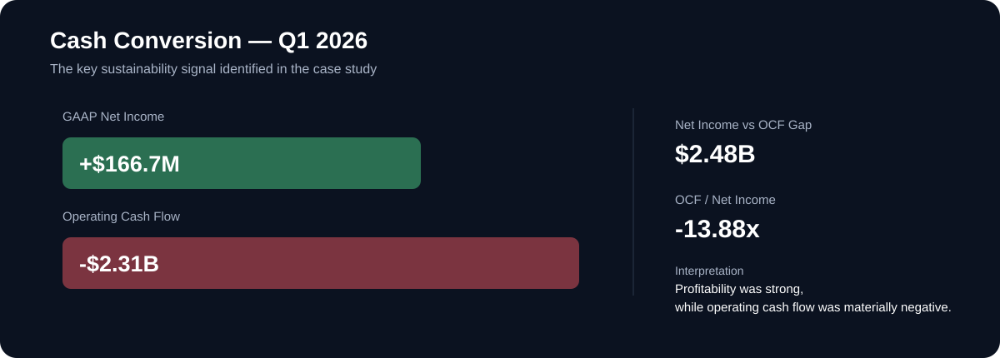

# SoFi Q1 2026 Growth Quality Assessment

> **[Open the live interactive website](https://sofi-q1-2026-growth-quality.netlify.app/)** · [View the HTML source in this repository](index.html)

I built this analysis to answer a question that matters in FinTech: was SoFi's Q1 2026 growth real, durable, and high-quality — or was it simply a strong headline story backed by volume?

The short answer is: the growth was meaningful, but the quality story was mixed.

## Snapshot

<table>
  <tr>
    <td></td>
    <td></td>
    <td></td>
  </tr>
</table>

## Business question

**Is SoFi's rapid Q1 2026 growth also high-quality and sustainable?**

SoFi was clearly growing fast. The issue was not whether the business was scaling — it was whether that scale was translating into deeper customer engagement, stronger unit economics, healthier funding, and more durable operating quality.

I approached the problem as a business analyst rather than a market commentator: using public filings, operating data, customer-friction signals, and a structured scorecard to separate volume growth from quality growth.

## Why this mattered

A lot of fintech stories are easy to read at the top line. Revenue is growing, members are increasing, products are expanding, and the market interprets that as momentum. The more important question is whether the growth is being supported by durable habits and healthy economics, or if it is mainly the result of adding volume faster than the business can convert it into stronger fundamentals.

That is the lens I used for this project.

## What I did

- Framed the business question and translated it into analytical requirements.
- Defined KPIs, formulas, denominators, and source traceability.
- Reviewed public SEC and investor materials alongside CFPB complaint evidence.
- Modeled the analysis in SQL and structured the outputs in Excel.
- Built a Power BI reporting layer and an interactive HTML summary for stakeholder presentation.
- Created a transparent scorecard to show where the quality story looked stronger and where it looked weaker.

## Key findings

| Metric | Q1 2026 |
|---|---:|
| Consolidated net revenue | $1.10B (+43% YoY) |
| GAAP net income | $166.7M |
| Members | 14.7M (+35% YoY) |
| Products | 22.2M (+39% YoY) |
| Loan originations | Approximately $12.2B |
| Products per member | Approximately 1.51 (project-derived) |
| Share of new products from existing members | 43% (company-reported) |

The strongest positive signal was the expansion of customer breadth. SoFi continued to add members and products at scale, and the company reported that 43% of new products came from existing members. That suggests the growth engine was not only acquiring more customers, but also deepening engagement within the current base.

However, the quality picture was more mixed than the headline growth implied.

### Cash conversion needs context

GAAP net income was **+$166.7M**, while net cash used in operating activities was **−$2.315B**. That is not a verdict on the business, but it is a reminder that strong earnings and weak cash conversion can coexist. For a growth-heavy financial platform, cash conversion has to be interpreted carefully alongside lending growth, funding structure, and operating leverage.

### Funding ratio is not a verdict

The project calculates approximately $40.24B deposits divided by $42.17B loans, or **95.4%**. This is a helpful directional signal, but it does not prove that deposits are the primary funding source for the entire loan book or that funding quality is strong across all liabilities. In other words, it is useful context, not a conclusion.

### Segment revenue denominator

The project-derived segment shares—Lending 56.1%, Financial Services 37.4%, and Technology Platform 6.6%—use the sum of reportable segment revenue (~$1.146B), not consolidated net revenue (~$1.10B). That distinction matters because the mix of growth is not always the same as the consolidated story.

### Credit and customer-friction signals

Reported total net charge-off rate was approximately **2.04%**, and the credit-card rate approximately **6.68%**. These are important indicators, but they are not a complete credit-risk assessment. They also need to be interpreted in context.

The complaint proxy was also directionally useful. The project reports **940 CFPB complaints** and approximately **63.92 complaints per million members** for Q1 2026. I treated this as an external operational signal rather than a formal service-quality metric. It is a useful idea test, but not a definitive verdict.

## My assessment

What stood out most to me was this:

- SoFi showed real customer expansion and product depth.
- The growth engine looked active and scalable.
- But the quality story was less clean than the headline growth suggested.
- Cash conversion, funding context, and customer-friction risk all required more careful interpretation.

That is why I did not treat the business as simply "strong" or "weak." The more honest conclusion is that the growth looked promising, but not yet fully de-risked.

## Growth Quality scorecard

I built the scorecard to summarize the signal quality across the core business dimensions, without pretending that a single number could settle the question. The scorecard below reflects analyst-assigned raw scores on a 1–5 scale, with separate weights for judgment-led emphasis.

| Dimension | Raw signal | Analyst-selected weight |
|---|---:|---:|
| Customer Depth | 4/5 | 1.20 |
| Funding Quality | 3/5 | 1.20 |
| Profitability | 4/5 | 1.10 |
| Credit Risk | 3/5 | 1.30 |
| Segment Diversification | 3/5 | 1.10 |
| Operational / Customer Friction | 3/5* | 1.00 |
| Cash Efficiency | 2/5 | 1.40 |
| Technology Platform Performance | 2/5 | 1.00 |

*The customer-friction score is provisional while the CFPB source evidence is incomplete.

This is not an official SoFi metric or management scorecard. It is my own evidence-based lens for testing whether the growth was supported by durable underlying quality.

## Direct project artifacts

- [Interactive HTML report](documents/SoFi_Q1_2026_Growth_Quality.html)
- [Power BI dashboard PDF](dashboard/SoFi_Q1_2026_Growth_Quality_Analysis_Dashboard.pdf)
- [Power BI file](dashboard/SoFi_2026_Growth_Quality_Dashboard.pbix)
- [Executive presentation](presentation/SoFi-Q1-2026-Growth-Quality-Assessment_.pdf)
- [Business and analytical requirements](documents/Business_Requirements_Analytical_Requirements.md)
- [KPI dictionary](documents/KPI_Dictionary.md)
- [Data source mapping](documents/Data_Source_Mapping.md)
- [GQI methodology](methodology/GQI_Methodology.md)
- [CFPB evidence notes](documents/CFPB_Evidence_Notes.md)
- [SQL scripts and run notes](sql/README.md)
- [Excel analytical bridge](analysis/SoFi_2026_Growth_Quality_PowerBI_Excel_Bridge.xlsx)

## What I learned

The biggest lesson from this work was that business quality is rarely visible in the headline numbers alone. Revenue growth, customer counts, and product expansion can all look strong while the underlying operating quality remains more mixed. The real value of the analysis was in checking the denominator, the context, and the trade-offs.

I also learned how important it is to separate a directional signal from a firm conclusion. Public data can be highly informative, but it is never the full story.

## Limitations and disclosure

This is an independent analysis based on public information, not an internal SoFi engagement. No internal customer-service, transaction, or management data were available. I did not use insider information, and this should not be interpreted as a management forecast, credit opinion, or investment recommendation.

## Primary sources

- [SEC — SoFi Q1 2026 Form 10-Q](https://www.sec.gov/Archives/edgar/data/1818874/000181887426000037/sofi-20260331.htm)
- [SoFi Investor Relations — Quarterly Results](https://investors.sofi.com/financials/quarterly-results/default.aspx)
- [SoFi Q1 2026 Earnings Release](https://s27.q4cdn.com/749715820/files/doc_financials/2026/q1/2026-Q1-Earnings-Release_FINAL.pdf)
- [CFPB Consumer Complaint Database](https://www.consumerfinance.gov/data-research/consumer-complaints/)
